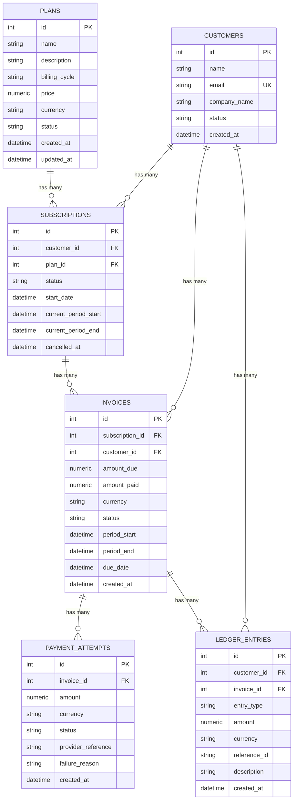
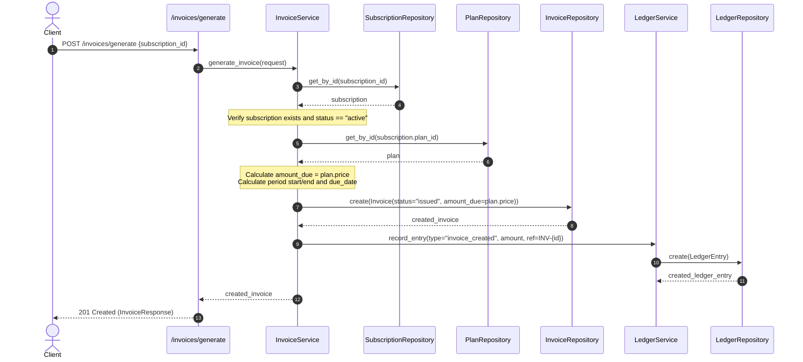
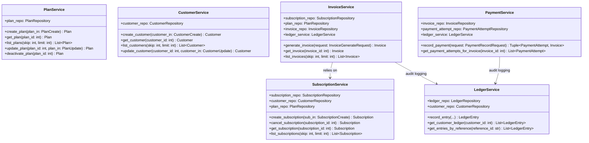

# SubLedger - Low-Level Design (LLD) Document

## 1. System Overview & Architectural Philosophy

**SubLedger** is a simplified, modular SaaS Subscription & Billing backend designed according to **SOLID** principles, the **Repository Pattern**, **Service Layer Pattern**, and **Dependency Injection**. It models the core lifecycle of subscription-based recurring revenue:
- Creating subscription plans
- Onboarding customers
- Managing subscription lifecycles (creation, period rollover, cancellation)
- Generating periodic invoices with pricing snapshots
- Recording multi-state payment attempts (successful, partial, failed)
- Maintaining an immutable, append-only **Financial Ledger** for auditability and reconciliation.

---

## 2. Entity Relationship Diagram (ERD)

The domain model establishes clean separation between plans, customer identities, recurring subscriptions, issued invoices, payment transaction attempts, and immutable ledger entries.



---

## 3. Service Responsibility Table

The **Service Layer** encapsulates all domain business logic, state transitions, calculations, and cross-entity workflows. Services do not interact directly with SQL or database sessions; instead, they operate via injected repositories.

| Service | What Logic It Owns | What It Should NOT Do |
|---|---|---|
| `PlanService` | Validates that plan prices are > 0, enforces supported billing cycles, manages plan creation and updates, handles plan deactivation. | Directly write raw SQL queries, handle HTTP request/response payloads, or manage subscription periods. |
| `CustomerService` | Enforces email normalization and uniqueness, manages customer registration, retrieval, and profile updates. | Compute subscription fees, generate invoices, or handle payment tokens. |
| `SubscriptionService` | Validates active customer and active plan constraints, prevents duplicate active subscriptions to the same plan, calculates billing periods, executes cancellation workflows. | Directly process payment attempts, execute DB commit/rollback mechanics, or generate invoices. |
| `InvoiceService` | Calculates `amount_due` snapshots from plan pricing, calculates billing period boundaries, generates draft/issued invoices, orchestrates `invoice_created` ledger entries. | Charge credit cards, execute raw database queries, or modify payment attempt tables. |
| `PaymentService` | Validates invoice existence and payable status, checks that payment amount does not exceed unpaid balance, computes status transitions (`partially_paid`, `paid`), persists payment attempt records, triggers ledger events. | Directly compute subscription renewals or modify plan pricing catalogs. |
| `LedgerService` | Creates immutable append-only ledger entries for auditing (`invoice_created`, `payment_success`, `payment_failure`), queries ledger histories by customer and reference ID. | Update or delete any existing ledger entry (enforces immutability). |

---

## 4. Repository Responsibility Table

The **Repository Pattern** abstracts the data access layer, decoupling SQL persistence from the core domain logic.

| Repository | Entities It Reads / Writes | Common Methods | Notes |
|---|---|---|---|
| `PlanRepository` | `Plan` | `get_by_id(id)`, `get_all(skip, limit)`, `get_active_plans()`, `create(plan)`, `update(plan)` | Handles plan persistence and active status filters. |
| `CustomerRepository` | `Customer` | `get_by_id(id)`, `get_by_email(email)`, `get_all(skip, limit)`, `create(customer)`, `update(customer)` | Provides fast email lookup for uniqueness checks. |
| `SubscriptionRepository` | `Subscription` | `get_by_id(id)`, `get_all(skip, limit)`, `get_active_by_customer_and_plan(customer_id, plan_id)`, `cancel(subscription)`, `create(sub)` | Queries active subscriptions to prevent invalid duplicate plans. |
| `InvoiceRepository` | `Invoice` | `get_by_id(id)`, `get_all(skip, limit)`, `get_by_subscription_id(sub_id)`, `get_by_customer_id(customer_id)`, `create(invoice)`, `update(invoice)` | Persists invoice state and balances. |
| `PaymentAttemptRepository` | `PaymentAttempt` | `get_by_id(id)`, `get_by_invoice_id(invoice_id)`, `get_by_provider_reference(ref)`, `create(attempt)` | Logs all payment attempts without mutations. |
| `LedgerRepository` | `LedgerEntry` | `create(entry)`, `get_by_id(id)`, `get_by_customer_id(customer_id)`, `get_by_reference_id(ref_id)`, `get_all(skip, limit)` | **Strictly append-only**: No `update` or `delete` methods exist in this repository. |

---

## 5. Business Rule Ownership Matrix

Every business requirement defined in the specification is explicitly assigned to a system layer:

| Business Rule | Layer / Location | Enforcement Mechanism |
|---|---|---|
| **1. Plan price must be greater than 0** | Schema (`PlanCreate`) + Service (`PlanService`) | `Field(..., gt=0)` Pydantic validation + explicit decimal check `price <= Decimal("0.00")` in service. |
| **2. Customer email must be unique** | Database Constraint + Repository + Service (`CustomerService`) | `unique=True` on `customers.email` + `get_by_email` query in `CustomerService.create_customer()`. |
| **3. A subscription cannot be created for an inactive plan** | Service (`SubscriptionService`) | `if plan.status != "active": raise BusinessRuleViolationError(...)`. |
| **4. Customer cannot have 2 active subscriptions to same plan** | Repository + Service (`SubscriptionService`) | `subscription_repo.get_active_by_customer_and_plan(...)` check before subscription creation. |
| **5. Invoice `amount_due` comes from plan price snapshot** | Service (`InvoiceService`) | `amount_due = plan.price` at the instant invoice is generated (protects against subsequent plan price edits). |
| **6. Successful payment cannot exceed remaining unpaid balance** | Service (`PaymentService`) | Computes `remaining_unpaid = invoice.amount_due - invoice.amount_paid` and rejects payments if `amount > remaining_unpaid`. |
| **7. Status updates: `paid` vs `partially_paid`** | Service (`PaymentService`) | If `new_amount_paid >= invoice.amount_due`: status becomes `paid`; else `partially_paid`. |
| **8. Failed payment does not increase `amount_paid`** | Service (`PaymentService`) | If `status == "failed"`, record failure reason in `payment_attempts` and leave invoice balance untouched. |
| **9. Ledger entries are append-only and traceable** | Repository (`LedgerRepository`) + Service (`LedgerService`) | `LedgerRepository` only implements `create` and `get_*`. Each entry stores `reference_id` (e.g., `INV-1`, `TXN-REF-123`). |

---

## 6. Design Patterns Used & Rationale

### A. Repository Pattern
- **Why chosen**: Keeps database access code isolated from application logic.
- **Benefits**:
  - Allows unit testing with mocks or in-memory databases without touching production SQL.
  - Keeps query logic unified and DRY (Don't Repeat Yourself).
  - Isolates ORM details (SQLAlchemy) so domain models and services remain clean.

### B. Service Layer Pattern
- **Why chosen**: Prevents the "Fat Controller" anti-pattern in FastAPI route functions.
- **Benefits**:
  - Route handlers only parse HTTP requests and format HTTP responses.
  - Domain workflows (e.g., generating an invoice, updating balances, logging ledger records) are encapsulated in services.
  - Transactions and business validation rules can be executed independently of HTTP (e.g., in background workers or CLI tasks).

### C. Dependency Injection (IoC)
- **Why chosen**: FastAPI's `Depends` system provides clean Inversion of Control.
- **Benefits**:
  - Services receive their required repositories in their `__init__` constructors.
  - Facilitates swapping out real database sessions with test sessions (as demonstrated in `tests/conftest.py`).

### D. Append-Only Ledger Pattern
- **Why chosen**: In financial systems, mutability leads to loss of audit trails and reconciliation errors.
- **Benefits**:
  - An invoice creation creates a positive credit/due record.
  - Successful or failed payments record distinct events with external reference IDs.
  - Total account history can always be audited and verified chronologically.

---

## 7. Core Workflows

### A. Invoice Generation Flow



**Step-by-step description:**
1. Endpoint receives `subscription_id` (and optional custom billing period or due date).
2. `InvoiceService` queries `SubscriptionRepository` for the subscription.
3. `InvoiceService` validates subscription exists and has status `"active"`.
4. `InvoiceService` fetches plan details from `PlanRepository` to capture a price snapshot.
5. `InvoiceService` calculates `amount_due` from `plan.price` and determines the billing period.
6. `InvoiceRepository` writes the invoice with initial status `"issued"` and `amount_paid = 0.00`.
7. `LedgerService` appends an `invoice_created` entry to the ledger with reference ID `INV-{invoice_id}`.
8. API returns the created invoice details.

---

### B. Payment Recording Flow

```mermaid
sequenceDiagram
    autonumber
    actor Client
    participant Route as /payments/record
    participant PS as PaymentService
    participant IR as InvoiceRepository
    participant PAR as PaymentAttemptRepository
    participant LS as LedgerService
    participant LR as LedgerRepository

    Client->>Route: POST /payments/record {invoice_id, amount, status, provider_reference}
    Route->>PS: record_payment(request)
    PS->>IR: get_by_id(invoice_id)
    IR-->>PS: invoice
    Note over PS: Validate invoice exists and is not void.<br/>Check remaining_unpaid = amount_due - amount_paid
    alt Payment is Success
        Note over PS: Check amount <= remaining_unpaid<br/>amount_paid += amount<br/>If paid in full -> status="paid"<br/>Else -> status="partially_paid"
        PS->>IR: update(invoice)
    else Payment is Failed
        Note over PS: Do NOT increase amount_paid.<br/>Invoice status remains unchanged.
    end
    PS->>PAR: create(PaymentAttempt(status, failure_reason))
    PAR-->>PS: payment_attempt
    PS->>LS: record_entry(type="payment_success"|"payment_failure", amount, ref)
    LS->>LR: create(LedgerEntry)
    LR-->>LS: ledger_entry
    PS-->>Route: (payment_attempt, updated_invoice)
    Route-->>Client: 201 Created (PaymentResultResponse)
```

**Step-by-step description:**
1. Endpoint receives payment payload: `invoice_id`, `amount`, `currency`, `status` ("success" or "failed"), `provider_reference`, and optional `failure_reason`.
2. `PaymentService` fetches invoice from `InvoiceRepository`.
3. `PaymentService` verifies invoice exists and computes `remaining_unpaid = amount_due - amount_paid`.
4. If payment is `success`:
   - Validates that `amount <= remaining_unpaid`. If exceeded, rejects with `BusinessRuleViolationError`.
   - Computes `new_amount_paid = amount_paid + amount`.
   - Updates invoice status to `"paid"` (if fully settled) or `"partially_paid"` (if balance remains).
5. If payment is `failed`:
   - `amount_paid` is NOT modified.
   - Failure reason is captured for troubleshooting.
6. `PaymentAttemptRepository` records the attempt record.
7. `LedgerService` appends a `payment_success` or `payment_failure` ledger entry linked to the customer and invoice with the provider reference.
8. API returns the payment attempt along with the updated invoice state.

---

## 8. Class Diagram


